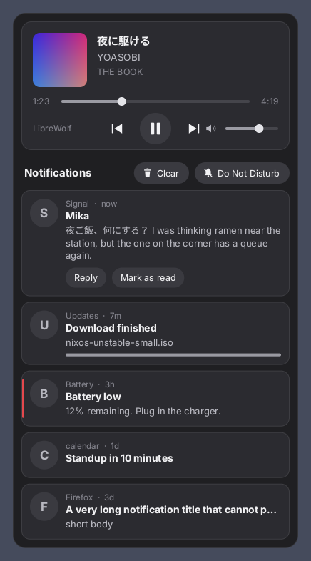
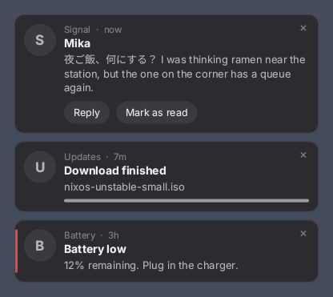
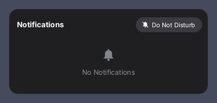

# notify-rs

A GNOME-style notification center and media card for Wayland, written in Rust
with **no dependencies**: not even the standard crates. D-Bus, Wayland, fonts
(TrueType, CFF and variable CFF2 such as NixOS's Noto CJK, with CJK fallback), PNG
and JPEG decoding are all implemented in this crate on top of `std`. About 14 000
lines, a 1.1 MB binary, and nothing to vendor.



It is three things in one process:

- a **notification daemon** (`org.freedesktop.Notifications` 1.2), so `notify-send`,
  Firefox, Signal, Discord and friends show up as toasts and are kept in a list;
- a **media card** for whatever plays through MPRIS (Firefox, LibreWolf, Chromium,
  mpv, Spotify, ...) with cover, time, seek bar, volume and prev/play/next;
- two **waybar modules** (`notify-rs waybar`, `notify-rs bell`) and a small CLI to
  drive all of it.

Click the music or bell module and the panel drops down centred under the bar.
Click anywhere else and it closes. It never takes keyboard focus.

| Toasts | Empty |
| --- | --- |
|  |  |

## What you need

- A Wayland compositor that offers **wlr-layer-shell**: Sway, Hyprland, niri, river,
  labwc, Wayfire, KDE Plasma. **GNOME's Mutter does not**, and notify-rs will tell
  you so and exit.
- Fonts installed on the system. Text is drawn by notify-rs itself:
  **JetBrainsMono Nerd Font Propo** for the interface and **Noto Sans CJK** for
  Japanese, Chinese and Korean (`nerd-fonts.jetbrains-mono` and `noto-fonts-cjk-sans`
  on NixOS). Anything neither of them has falls back to your system's `sans-serif`; if
  JetBrains is missing, the system sans comes first, so Latin text is never set in a CJK
  face. Fonts are found through `fc-match` when it exists, otherwise by scanning the
  usual directories (including the NixOS ones). `notify-rs fonts` prints which files are
  used and which one draws Latin, kana, kanji and hangul.
  The waybar icons come from whatever font *waybar* uses: Nerd Fonts **v3**.
- Optional: `curl` on `PATH`, only to fetch `https://` cover art (Chromium and YouTube
  Music report that). `file://` covers, which Firefox and LibreWolf use, need nothing.
- Only one notification daemon can own the bus name. **Stop mako, dunst, swaync, ...**
  first; notify-rs refuses to start and says who has it otherwise.

## Install

### NixOS (flake)

```nix
# flake.nix
inputs.notify-rs.url = "path:/home/you/notify-rs";   # or a git URL
inputs.notify-rs.inputs.nixpkgs.follows = "nixpkgs";

# in your NixOS configuration
imports = [ inputs.notify-rs.nixosModules.default ];
services.notify-rs.enable = true;   # installs the binary and a systemd user service
```

Or just the package: `inputs.notify-rs.packages.${system}.default`, or the overlay
`inputs.notify-rs.overlays.default` (adds `pkgs.notify-rs`). Try it without installing:
`nix run path:/home/you/notify-rs -- daemon`.

With **Home Manager** instead of the NixOS module:

```nix
home.packages = [ inputs.notify-rs.packages.${pkgs.system}.default ];
systemd.user.services.notify-rs = {
  Unit = { Description = "notify-rs"; PartOf = [ "graphical-session.target" ]; After = [ "graphical-session.target" ]; StartLimitIntervalSec = 0; };
  Service = { ExecStart = "${inputs.notify-rs.packages.${pkgs.system}.default}/bin/notify-rs daemon"; Restart = "on-failure"; RestartSec = 2; };
  Install.WantedBy = [ "graphical-session.target" ];
};
```

Also make sure fonts are installed, e.g. `fonts.packages = with pkgs; [ nerd-fonts.jetbrains-mono noto-fonts-cjk-sans ];`.

### Anywhere else

```sh
cargo build --release          # needs only a Rust toolchain
install -Dm755 target/release/notify-rs ~/.local/bin/notify-rs
```

## Run it

Start `notify-rs daemon` once per session. Any of these works:

```
# Hyprland
exec-once = notify-rs daemon
# Sway
exec notify-rs daemon
# niri (config.kdl)
spawn-at-startup "notify-rs" "daemon"
```

or the systemd user unit in [`contrib/notify-rs.service`](contrib/notify-rs.service)
(it needs `WAYLAND_DISPLAY` in the systemd user environment; UWSM and most NixOS
setups provide it). The daemon exits with a message, instead of half-working, if it
cannot reach Wayland or if another daemon owns the notification name. It does not take
the name until the Wayland connection is up, so a broken display never swallows
notifications.

## Waybar

Merge [`contrib/waybar/config.jsonc`](contrib/waybar/config.jsonc) and
[`contrib/waybar/style.css`](contrib/waybar/style.css) into your setup. The short
version:

```jsonc
"custom/music": {
  "exec": "notify-rs waybar --icon-only", "return-type": "json", "format": "{}",
  "on-click": "notify-rs center toggle", "on-click-middle": "notify-rs toggle",
  "on-scroll-up": "notify-rs vol +5", "on-scroll-down": "notify-rs vol -5"
},
"custom/notifications": {
  "exec": "notify-rs bell", "return-type": "json", "format": "{}",
  "on-click": "notify-rs center toggle", "on-click-right": "notify-rs dnd toggle",
  "on-click-middle": "notify-rs clear"
}
```

The bell's text is always an icon followed by one space, so waybar does not clip the
glyph at the edge of the module: `󰂚 ` (U+F009A) when nothing is waiting, `󱅫 `
(U+F116B) when something is, and `󰂛 ` (U+F009B) under Do Not Disturb. The count is not
in the text; it is in the tooltip and in the JSON `percentage` field.
They are Nerd Fonts v3 glyphs, so waybar needs a v3 Nerd Font (the same
JetBrainsMono Nerd Font works).

Both commands stream one JSON line per change and survive tab switches in the browser
(the track does not vanish while the player briefly reports nothing). While the panel
is open its backdrop covers the bar too, so clicking the bell or music button just
closes the panel.

## Command line

```
notify-rs daemon [--headless]       run the daemon and panel (--headless: no window)
notify-rs center [toggle|open|close]
notify-rs dnd [toggle|on|off]       Do Not Disturb
notify-rs clear                     dismiss everything
notify-rs state                     open=false dnd=false count=3
notify-rs send [-u low|normal|critical] [-t MS] [-a APP] [-i ICON] [-r ID] [-p]
               [-h TYPE:NAME:VALUE]... SUMMARY [BODY]
notify-rs waybar [--max-len N] [--icon-only]
notify-rs bell [--hide-empty]
notify-rs status | art | toggle | play | pause | stop | next | prev | vol +5|-5|40
notify-rs preview OUT.png [--scale N] [--empty] [--no-media] [--toasts] [--hover ID]
```

`notify-rs art` shows where the current cover comes from and its real pixel size.
`notify-rs preview` draws the panel with sample content into a PNG, which is how the
screenshots above were made, and a quick way to check that your fonts work.

## Behaviour

Modelled on GNOME Shell:

- Toasts last 6 s (4 s for low urgency), **critical ones stay** until dismissed, and a
  toast under the pointer is not dismissed. `-t 0` means "until dismissed".
  Anything under 1 s is raised to 1 s.
- At most three toasts at a time; the rest wait in the list. Opening the panel hides the toasts.
- Do Not Disturb silences toasts (critical ones still show, as in GNOME) but everything
  is still kept in the list.
- Replacing (`replaces_id`, `x-canonical-private-synchronous`), actions, `resident`,
  `transient`, `urgency`, progress (`value` hint), `image-data`, `image-path`, and file
  icon paths are supported. Clicking a notification runs its `default` action;
  other actions become buttons. Invoking an action closes the notification unless it
  is resident. Middle-click dismisses.
- The panel scrolls with the wheel; over the volume slider the wheel changes volume
  by 5 % a notch. Seeking commits when the knob is released.

Not supported, on purpose or not yet: body markup is stripped rather than rendered,
icon *names* (`dialog-information`) are not looked up in an icon theme (a letter avatar
is shown instead), there is no kerning and no colour emoji, no WebP covers,
fonts with TrueType variations (`gvar`) draw their default instance, and `Esc` cannot close the panel because it never takes keyboard focus (click away instead).

## How it is tested

`cargo test` runs 237 tests:

- the D-Bus layer, MPRIS tracker and notification service against a real `dbus-daemon`;
- the PNG and JPEG decoders **bit for bit** against libjpeg-turbo/Pillow on 78 fixtures
  (baseline, progressive, 4:2:0/4:2:2/4:4:4, CMYK, restart intervals, truncated and
  corrupted files);
- font rendering against reference metrics, including variable CFF2 fonts checked
  against fontTools output;
- the Wayland client and the whole daemon against `tools/mock_compositor.py`, a
  deliberately strict Wayland server that checks object ids, argument types, buffer
  sizes, configure/ack ordering and shared-memory handling, dumps every committed
  buffer as a PNG, and injects pointer events. `tests/ui_live.rs` starts the real
  `notify-rs daemon` on a real session bus and drives it: toasts, panel, click-away,
  action buttons, DND, clear, media controls, seeking, cover art, fractional scaling.

The mock compositor tests need `python3` with Pillow and a `dbus-daemon`; those tests
skip themselves when they are missing. `nix develop` provides all of it.

**What has not been verified:** the Wayland side was only ever run against that mock,
never against Sway, Hyprland or niri, because there was no real compositor to run it
on. The protocol requests were checked against the published protocol definitions
and the mock rejects anything out of order, but real compositors differ in details
(surface stacking, output selection, scale events). If something looks wrong on yours,
run `notify-rs daemon` from a terminal: it prints the reason whenever it gives up.

## Layout

```
src/dbus/    wire format, authentication, connection
src/wl/      Wayland wire format, protocol table, client (layer-shell, shm, pointer)
src/gfx/     canvas, anti-aliased rasteriser, TrueType/CFF fonts, icons, PNG writer
src/image/   inflate, PNG and JPEG decoders
src/ui/      panel and toast drawing, the event loop (app.rs), preview
src/mpris.rs, notify.rs, service.rs   media tracking, notification model, D-Bus service
tools/       mock compositor, fixture and reference generators
```

## License

MIT
